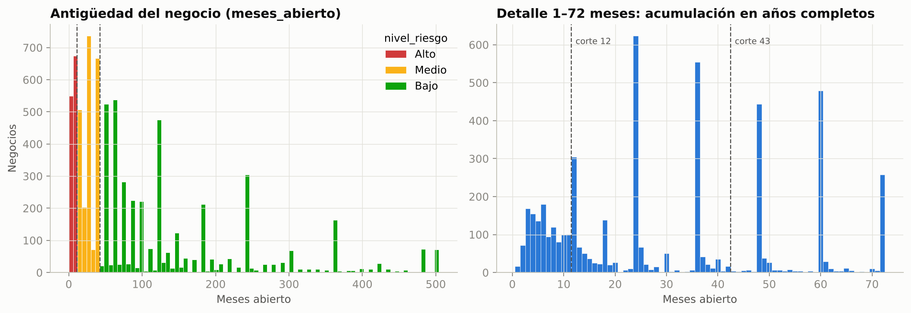
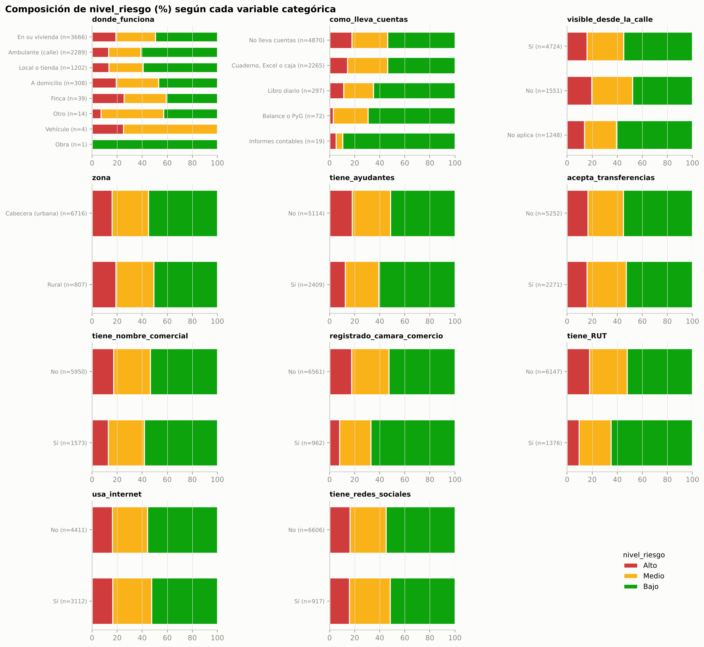
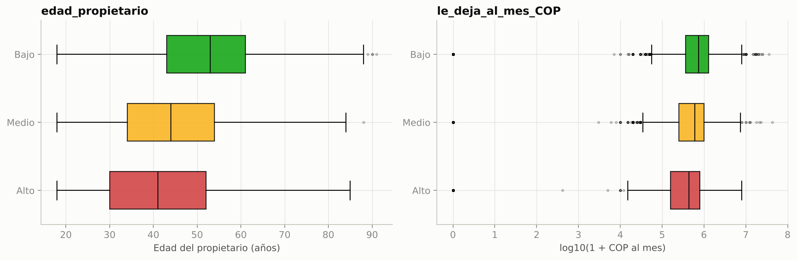
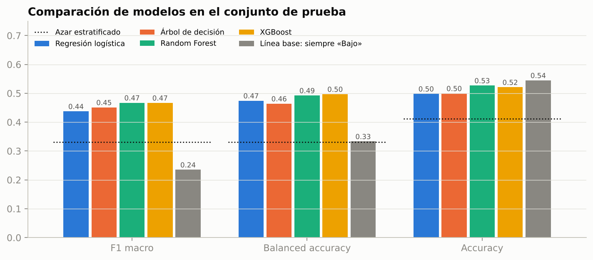
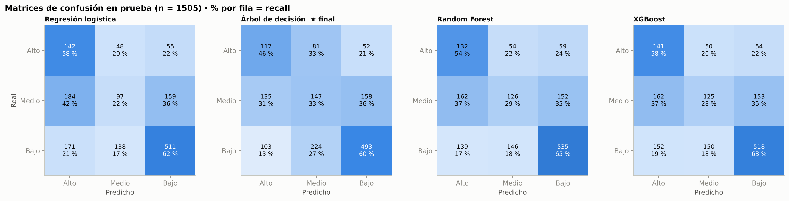
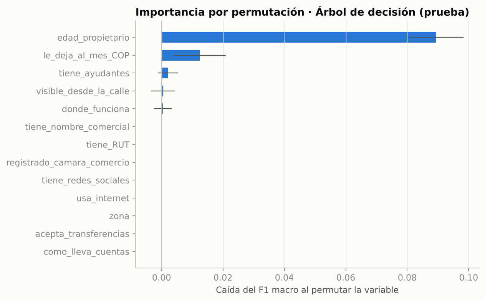
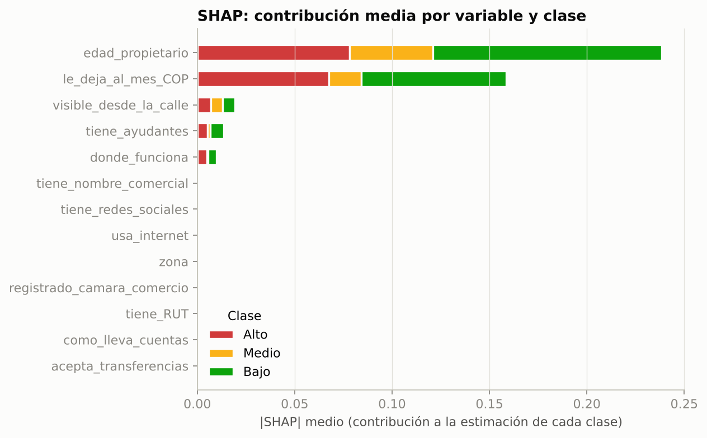

# Informe técnico · Clasificación del nivel de riesgo de negocios de comida en Colombia

*Proyecto final · Maestría en Ciencia de Datos / Especialización en Machine Learning*
*Todas las cifras de este informe provienen de la ejecución del código del repositorio (semilla 42). Las tablas fuente están en `reports/tables/`.*

---

## 1. Problema de negocio

Los micronegocios de comida son una fuente importante de empleo e ingreso en Colombia, pero muchos no sobreviven a sus primeros años. Interesa saber si, a partir de características observables de un negocio (formalidad, uso de herramientas digitales, forma de operar, perfil del propietario e ingreso), es posible reconocer si **se parece** a los negocios jóvenes —más expuestos— o a los ya establecidos.

**Pregunta orientadora:** ¿qué nivel de riesgo puede tener un negocio de comida, según sus características, usando la antigüedad del negocio como criterio para definir las categorías de riesgo?

**Precisión metodológica:** como la etiqueta se construye con la antigüedad, el modelo aprende a predecir *categorías de antigüedad*. Esto **no** demuestra la probabilidad de que un negocio cierre en el futuro: la encuesta solo contiene negocios abiertos.

## 2. Objetivos

**General.** Desarrollar un sistema de clasificación supervisada que, a partir de características observables de un negocio de comida, prediga su categoría de `nivel_riesgo` (Alto, Medio, Bajo) y ponerlo a disposición en una aplicación web.

**Específicos.**
1. Inspeccionar y documentar la base EMICRON 2024 de negocios de comida.
2. Construir de forma reproducible y justificada la variable objetivo a partir de `meses_abierto`.
3. Auditar la fuga de información y definir las variables predictoras.
4. Entrenar y comparar regresión logística, árbol de decisión, Random Forest y XGBoost con validación cruzada estratificada.
5. Evaluar el modelo elegido en un conjunto de prueba aislado y explicar sus predicciones.
6. Desplegar el modelo en una aplicación web con API, pruebas automatizadas e instrucciones.

## 3. Fuente de datos

* **Origen:** Encuesta de Micronegocios (EMICRON) 2024, DANE. Micronegocios con hasta 9 trabajadores.
* **Archivo:** `BASE_1_EMICRON_2024_comida_DANE.xlsx`, preparado por el equipo a partir del archivo técnico del DANE (218 columnas con códigos originales; la hoja LEEME menciona `emicron_2024_comida_alojamiento.csv`, que **no** está en el repositorio).
* **Hojas:** `LEEME` (contexto), `Datos` (7.523 filas × 16 columnas), `Resumen` (porcentajes de riesgo financiero por respuesta) y `Diccionario` (significado, respuestas posibles y pregunta original del DANE).
* **Integridad:** el código verifica la huella SHA-256 del Excel antes de usarlo; la base original nunca se modifica.

### 3.1 Hallazgos de calidad de datos

| Aspecto | Hallazgo | Decisión |
|---|---|---|
| Nulos | 0 en todas las columnas | Se dejan imputadores en el pipeline por robustez (no actúan con esta base) |
| Duplicados | 0 filas duplicadas; 19 coinciden en todo salvo `id_negocio` | Se conservan: son negocios distintos con las mismas respuestas |
| `meses_abierto` | 1 a 500; mediana 48; acumulación en años completos (12, 24, 36…); 70 casos = 500 | Sin valores inválidos. El 500 parece un tope; no afecta la etiqueta (siempre "Bajo") |
| `le_deja_al_mes_COP` | 0 a 43.093.000; mediana 600.000; asimetría 10,4; 155 ceros; 404 atípicos por IQR | Se conservan (respuestas plausibles); `log1p` dentro del pipeline |
| `edad_propietario` | 18 a 91; un atípico por IQR (91) | Se conserva |
| `riesgo_financiero` | Coincide en el 100 % con `le_deja_al_mes_COP < 650.000` | Redundante; se excluye |
| Categorías raras | `donde_funciona`: Vehículo (4), Obra (1, no está en el diccionario), Otro (14); `como_lleva_cuentas`: Informes contables (19) | Agrupación "infrecuente" en el One-Hot (umbral 20 en entrenamiento) |
| Consistencia | Ningún negocio es más antiguo que la edad de su dueño; 11 abrieron antes de que el dueño cumpliera 10 años (posible herencia) | Se conservan |
| Documentación | LEEME y Diccionario fueron escritos para un objetivo anterior (`riesgo_financiero`) | Las advertencias de fuga se reevaluaron para `nivel_riesgo` |

## 4. Diccionario resumido de variables y auditoría de fuga

| Variable | Tipo | Descripción (pregunta DANE) | Uso | Decisión | Justificación |
|---|---|---|---|---|---|
| `meses_abierto` | entero | Edad del negocio en meses (P3034) | **Construcción de la etiqueta** | Excluida de X | Fuente directa de la etiqueta |
| `nivel_riesgo` | categórica | Alto / Medio / Bajo | **Variable objetivo (y)** | Excluida de X | Es lo que se predice |
| `id_negocio` | entero | Número de fila | Ninguno | Excluida | Identificador sin información del negocio |
| `riesgo_financiero` | categórica | Sí si ingreso < $650.000 | Ninguno | Excluida | Transformación determinística del ingreso; redundante |
| `donde_funciona` | categórica | Dónde funciona (P3053) | Predictora | Incluida | Característica observable, conocida al predecir |
| `como_lleva_cuentas` | categórica | Forma de llevar cuentas (P640) | Predictora | Incluida | Ídem |
| `tiene_ayudantes` | binaria | Alguien le ayuda (P3031) | Predictora | Incluida | Ídem |
| `acepta_transferencias` | binaria | Pagos digitales (P1764_3) | Predictora | Incluida | Ídem |
| `tiene_nombre_comercial` | binaria | Nombre comercial (P3035) | Predictora | Incluida | Ídem |
| `registrado_camara_comercio` | binaria | Registro mercantil (P1055) | Predictora | Incluida | Ídem |
| `tiene_RUT` | binaria | RUT ante la DIAN (P1633) | Predictora | Incluida | Ídem |
| `visible_desde_la_calle` | categórica | Sí / No / No aplica (P469) | Predictora | Incluida | Ídem |
| `usa_internet` | binaria | Usa internet (P2524) | Predictora | Incluida | Ídem |
| `tiene_redes_sociales` | binaria | Redes sociales (P1559) | Predictora | Incluida | Ídem |
| `zona` | categórica | Cabecera / Rural (CLASE_TE) | Predictora | Incluida | Ídem |
| `edad_propietario` | entero | Edad del dueño (P241) | Predictora | Incluida | Ver 4.1 |
| `le_deja_al_mes_COP` | entero | Ganancia mensual (P3072) | Predictora | Incluida | Ver 4.1 |

### 4.1 Revisión de las variables especiales

**`le_deja_al_mes_COP`.** Representa lo que el negocio le deja al dueño al mes según su propia respuesta. (a) Está disponible al momento de predecir: el dueño la conoce y la reporta en la misma encuesta. (b) Su definición no usa `meses_abierto` ni `nivel_riesgo`. (c) Su relación con la antigüedad es débil (Spearman 0,18): no permite reconstruir la etiqueta. (d) El diccionario la marca como "fuga", pero esa advertencia se refería al objetivo anterior (`riesgo_financiero`, que se calcula con ella). Para `nivel_riesgo` su inclusión es apropiada. **Decisión: incluir.** Se documenta que es un resultado contemporáneo (no anterior) al momento de la encuesta.

**`riesgo_financiero`.** Es exactamente `le_deja_al_mes_COP < 650.000` (coincidencia del 100 %). No contiene información de la antigüedad, pero es redundante con el ingreso y añade un umbral arbitrario. **Decisión: excluir** (y no se pide en el formulario).

**`edad_propietario`.** Disponible al predecir y no derivada de la etiqueta. Tiene correlación moderada con la antigüedad (r = 0,42), lo cual es lógico: un negocio de 20 años suele tener un dueño mayor. Es una señal legítima, no una reconstrucción de la etiqueta. **Decisión: incluir**, con análisis de sensibilidad (sección 8.3) y una nota ética: el modelo no debe usarse para tomar decisiones sobre personas por su edad.

### 4.2 Controles contra la fuga implementados en el código
* `assert_no_leakage` falla si `meses_abierto`, `nivel_riesgo`, `riesgo_financiero` o `id_negocio` aparecen en X; `train.py` lo vuelve a comprobar antes de entrenar y hay pruebas automáticas.
* División 80/20 **antes** de cualquier ajuste; imputación, codificación, escalado y pesos de clase se ajustan dentro de cada pliegue (`Pipeline`).
* Los hiperparámetros y el modelo final se eligen solo con CV; el test se usa una vez.
* La API rechaza solicitudes que incluyan `meses_abierto`, `nivel_riesgo` o `riesgo_financiero`.

## 5. Variable objetivo: `nivel_riesgo`

### 5.1 Regla (decisión metodológica del proyecto; no es una clasificación oficial del DANE)

| Clase | Regla exacta | Registros | % |
|---|---|---|---|
| **Alto** | 1 ≤ `meses_abierto` ≤ 11 | 1.224 | 16,27 % |
| **Medio** | 12 ≤ `meses_abierto` ≤ 42 | 2.200 | 29,24 % |
| **Bajo** | `meses_abierto` ≥ 43 | 4.099 | 54,49 % |

Las clases no se solapan (máximo de Alto = 11 < mínimo de Medio = 12; máximo de Medio = 42 < mínimo de Bajo = 43) y cubren los 7.523 registros. Un `meses_abierto` nulo, ≤ 0 o no numérico deja el registro sin etiqueta y se excluye del modelado (0 casos en esta base). Todo está en `src/data_processing.py::assign_risk_level` y se verifica con pruebas.

### 5.2 Justificación
* **Negocio:** el primer año es la etapa más frágil. Los estudios de supervivencia empresarial de Confecámaras reportan que la mayor caída ocurre en el primer año y que cerca de un tercio de las empresas creadas en 2017 seguía activa en 2022 (cifras difundidas por prensa; ver sección 15).
* **Referencia académica:** el *Global Entrepreneurship Monitor* (GEM) distingue a los dueños de *negocios nuevos* (hasta 42 meses pagando salarios o ingresos) de los de *negocios establecidos* (más de 42 meses). El corte Medio/Bajo usa ese umbral.
* **Distribución de los datos:** las respuestas se redondean a años. El ejemplo ilustrativo 12/36 pondría el corte justo sobre un pico (555 negocios = 36 meses), lo que haría la frontera frágil. El corte en 42/43 cae en una zona con pocos casos (37–47 meses: 156 negocios). Las clases resultantes (16/29/54 %) tienen un desbalance moderado y manejable.
* **Interpretación:** asociar menor antigüedad con mayor riesgo es una **aproximación**. Ningún negocio de la base cerró; "Alto" significa "se parece a los negocios en su primer año", no "va a cerrar".
* Los umbrales se fijaron **antes** de entrenar; no se eligieron por las métricas.



## 6. Metodología CRISP-DM

| Fase | Qué se hizo | Dónde |
|---|---|---|
| 1. Comprensión del negocio | Pregunta, objetivos, alcance y límites de la etiqueta | Secciones 1–2 |
| 2. Comprensión de los datos | Inspección de las 4 hojas, tipos, nulos, duplicados, atípicos, diccionario | `src/eda.py`, sección 3 |
| 3. Preparación | Limpieza mínima, etiqueta, auditoría de fuga, división 80/20, pipelines | `src/data_processing.py`, `src/modeling.py` |
| 4. Modelado | 4 modelos con búsqueda de hiperparámetros y CV estratificada | `src/train.py` |
| 5. Evaluación | Métricas en test, matrices de confusión, errores, interpretabilidad | `src/evaluate.py` |
| 6. Despliegue | API FastAPI + interfaz web + pruebas + Docker | `app/`, `tests/`, `Dockerfile` |

## 7. Análisis exploratorio (resumen)



* Las variables categóricas muestran diferencias **pequeñas** entre clases. Por ejemplo, el 8 % de los negocios registrados en Cámara de Comercio es "Alto", frente al 18 % de los no registrados; los que tienen ayudantes son "Bajo" en un 61 %, frente al 51 % de los que no.
* Las dos variables numéricas separan más: la mediana de edad del propietario es 41 años en "Alto", 44 en "Medio" y 53 en "Bajo"; la mediana del ingreso es $440.000, $600.000 y $750.000 respectivamente.
* `usa_internet` y `zona` casi no cambian la composición de clases.
* Conclusión: se anticipa un desempeño **modesto**, dominado por edad e ingreso.



## 8. Preparación de los datos y estrategia de validación

### 8.1 Preprocesamiento (dentro del `Pipeline`, ajustado solo con entrenamiento)
| Tipo | Variables | Transformación |
|---|---|---|
| Categóricas y binarias | 11 | Imputación por moda → One-Hot; categorías con < 20 casos en entrenamiento → "infrecuente"; categorías nuevas → "infrecuente" |
| Edad | `edad_propietario` | Imputación por mediana (+ escalado estándar solo en regresión logística) |
| Ingreso | `le_deja_al_mes_COP` | Imputación por mediana → `log1p` (+ escalado solo en regresión logística) |

No se escalan los modelos de árboles porque no lo necesitan. No se eliminan atípicos: son respuestas plausibles y `log1p` reduce su influencia.

### 8.2 Validación
* **División:** 80 % entrenamiento (6.018) / 20 % prueba (1.505), estratificada por `nivel_riesgo`, `random_state = 42`.
* **CV:** `StratifiedKFold` de 5 pliegues con barajado (semilla 42), solo sobre el entrenamiento.
* **Métrica principal:** F1 macro (pondera igual las tres clases). Se registran además balanced accuracy, accuracy y F1 ponderado.
* **Desbalance:** `class_weight="balanced"` (logística, árbol, Random Forest) y `sample_weight` balanceado en XGBoost, calculado dentro de cada pliegue. No se usa sobremuestreo ni SMOTE.
* **Criterio de selección (regla de un error estándar; Hastie, Tibshirani y Friedman, 2009, sec. 7.10):** se toma el mejor F1 macro medio de CV y se calcula su error estándar (desviación estándar muestral de los 5 pliegues dividida por √5); los modelos con F1 macro medio mayor o igual que *mejor media − 1 error estándar* se consideran equivalentes, y entre ellos se elige el más simple e interpretable (logística < árbol < Random Forest < XGBoost). El test no interviene.

### 8.3 Sensibilidad de variables (CV en entrenamiento, modelo final)

| Escenario | F1 macro CV (± desv. entre pliegues) |
|---|---|
| Todas las variables aprobadas (13) | 0,448 ± 0,011 |
| Sin `le_deja_al_mes_COP` | 0,400 ± 0,022 |
| Sin `edad_propietario` | 0,353 ± 0,028 |
| Sin ingreso ni edad | 0,371 ± 0,021 |

Sin edad e ingreso el modelo queda cerca del azar (0,33). Que "sin ingreso ni edad" supere levemente a "sin edad" se explica porque los hiperparámetros se fijaron para el conjunto completo y por la variación entre pliegues.

## 9. Los cuatro modelos

| Modelo | Cómo funciona | Configuración y espacio de búsqueda | Mejores hiperparámetros |
|---|---|---|---|
| **Regresión logística** | Combina las variables con pesos y convierte el puntaje de cada clase en una estimación de pertenencia (softmax). Lineal e interpretable por coeficientes. | L2, `class_weight="balanced"`, escalado; rejilla C ∈ {0,001 … 10} (9 valores) | C = 10 |
| **Árbol de decisión** | Divide los datos con preguntas sucesivas («¿edad ≤ 40,5?») hasta llegar a grupos con una clase dominante. | `class_weight="balanced"`; rejilla: profundidad {2,3,4,5,6,8,10} × hoja mínima {5,10,20,50,100} × criterio {gini, entropía} (70) | Profundidad 4, hoja ≥ 50, gini |
| **Random Forest** | Promedia muchos árboles entrenados con muestras y variables aleatorias; reduce la varianza de un solo árbol. | `class_weight="balanced"`; 40 combinaciones aleatorias de n.º de árboles, profundidad, hoja mínima y `max_features` | 600 árboles, profundidad 6, hoja ≥ 10, `max_features` 0,5 |
| **XGBoost** | *Gradient boosting*: agrega árboles pequeños en secuencia, cada uno corrige los errores del anterior, con regularización. | `sample_weight` balanceado; 40 combinaciones de n.º de árboles, tasa de aprendizaje, profundidad, `min_child_weight`, submuestreo y `reg_lambda` | 362 árboles, tasa 0,014, profundidad 3 |

Se compararon estos cuatro porque cubren un espectro de complejidad: un modelo lineal de referencia, un modelo de reglas interpretable y dos ensambles de árboles (*bagging* y *boosting*) que suelen ser los más fuertes en datos tabulares.

## 10. Resultados

### 10.1 Validación cruzada (entrenamiento)
| Modelo | F1 macro | Desv. entre pliegues | Error estándar | Balanced acc. | Accuracy | F1 macro en entrenamiento |
|---|---|---|---|---|---|---|
| Regresión logística | 0,4269 | 0,011 | 0,0055 | 0,460 | 0,493 | 0,441 |
| Árbol de decisión | 0,4479 | 0,011 | 0,0054 | 0,465 | 0,494 | 0,464 |
| Random Forest | 0,4460 | 0,007 | 0,0035 | 0,470 | 0,513 | 0,512 |
| XGBoost | **0,4503** | 0,013 | 0,0067 | 0,474 | 0,516 | 0,487 |

*Desv. entre pliegues: desviación estándar del F1 macro en los 5 pliegues, calculada con n = 5; describe la variabilidad. Error estándar: desviación estándar muestral (n − 1) dividida por √5; mide la incertidumbre de la media y es el valor que usa la regla de selección.*

Error estándar del mejor modelo (XGBoost): 0,0149 / √5 = 0,0067. Umbral de equivalencia: 0,4503 − 0,0067 = 0,4436. Árbol (0,4479), Random Forest (0,4460) y XGBoost quedan dentro; la logística (0,4269) no. Se elige el **árbol de decisión**.

### 10.2 Conjunto de prueba (1.505 negocios, usado una sola vez)
| Modelo | Accuracy | Balanced acc. | Precision macro | Recall macro | **F1 macro** | F1 ponderado | Log-loss | Brier medio |
|---|---|---|---|---|---|---|---|---|
| Regresión logística | 0,498 | 0,474 | 0,444 | 0,474 | 0,438 | 0,501 | 0,998 | 0,198 |
| **Árbol de decisión** | 0,500 | 0,464 | 0,449 | 0,464 | **0,451** | 0,510 | 1,005 | 0,200 |
| Random Forest | 0,527 | 0,493 | 0,470 | 0,493 | 0,467 | 0,532 | 0,982 | 0,195 |
| XGBoost | 0,521 | 0,497 | 0,470 | 0,497 | 0,467 | 0,527 | 0,981 | 0,195 |
| Azar estratificado | 0,411 | 0,331 | 0,331 | 0,331 | 0,331 | 0,412 | — | 0,393 |
| Siempre «Bajo» | 0,545 | 0,333 | 0,182 | 0,333 | 0,235 | 0,384 | — | 0,303 |



### 10.3 Métricas por clase en prueba (F1; precisión / recall)
| Modelo | Alto (n = 245) | Medio (n = 440) | Bajo (n = 820) |
|---|---|---|---|
| Regresión logística | 0,383 (0,29 / 0,58) | 0,268 (0,34 / 0,22) | 0,661 (0,71 / 0,62) |
| **Árbol de decisión** | 0,376 (0,32 / 0,46) | **0,330** (0,33 / 0,33) | 0,647 (0,70 / 0,60) |
| Random Forest | 0,389 (0,31 / 0,54) | 0,329 (0,39 / 0,29) | 0,683 (0,72 / 0,65) |
| XGBoost | 0,403 (0,31 / 0,58) | 0,327 (0,39 / 0,28) | 0,671 (0,71 / 0,63) |



### 10.4 Qué significan las métricas
* **Accuracy:** % de aciertos. Engaña con clases desbalanceadas: "siempre Bajo" tiene la mayor accuracy (0,545) y no sirve para nada.
* **Precision de una clase:** de los negocios que el modelo puso en esa clase, cuántos eran de ella.
* **Recall de una clase:** de los negocios de esa clase, cuántos encontró el modelo.
* **F1:** media armónica de precision y recall. **F1 macro:** promedio simple del F1 de las tres clases (cada clase pesa igual).
* **Balanced accuracy:** promedio del recall de las tres clases.

### 10.5 Justificación del modelo final
1. En CV, el árbol (0,448) está a menos de un error estándar del mejor modelo (XGBoost, 0,450; error estándar 0,007).
2. Es el modelo equivalente más simple: 4 niveles, se puede dibujar y explicar regla por regla; la aplicación muestra el camino exacto que siguió cada predicción.
3. Es el más equilibrado en la clase difícil (Medio): precision y recall de 0,33, mientras los demás sacrifican recall de Medio (0,22–0,29).
4. Sobreajuste bajo (F1 entrenamiento 0,464 vs CV 0,448).

**Hallazgo honesto:** en el test, Random Forest y XGBoost superan al árbol en 0,016 de F1 macro, del mismo orden que la desviación entre pliegues. No se cambió la decisión por ese resultado, porque eso sería ajustar el modelo con el test. Si se priorizara el desempeño sobre la interpretabilidad, XGBoost sería la alternativa recomendada.

### 10.6 Errores más relevantes (modelo final, prueba)
| Tramo real de meses | Clase real | Registros | Tasa de error |
|---|---|---|---|
| 1–6 | Alto | 139 | 56,8 % |
| 7–11 | Alto | 106 | 50,9 % |
| 12–24 | Medio | 278 | 65,5 % |
| 25–42 | Medio | 162 | 68,5 % |
| 43–60 | Bajo | 208 | 55,3 % |
| 61–120 | Bajo | 299 | 45,2 % |
| > 120 | Bajo | 313 | 24,6 % |

* El error más común es confundir clases **vecinas**: 33 % de los "Alto" se predicen "Medio" y 27 % de los "Bajo" se predicen "Medio".
* Los negocios de más de 10 años se reconocen mucho mejor; cerca de los cortes (11 vs 12 meses; 42 vs 43) los negocios son prácticamente iguales y caen en clases distintas.
* 13 % de los "Bajo" se clasifican como "Alto": suelen ser negocios con dueños jóvenes o ingresos bajos.

## 11. Interpretabilidad

| Variable | Importancia por permutación (caída de F1 macro en test) | Importancia en el árbol |
|---|---|---|
| `edad_propietario` | 0,090 ± 0,009 | 60,2 % |
| `le_deja_al_mes_COP` | 0,012 ± 0,009 | 34,7 % |
| `tiene_ayudantes` | 0,002 | 1,8 % |
| `visible_desde_la_calle` | 0,001 | 2,2 % |
| `donde_funciona` | 0,000 | 1,1 % |
| Las otras 8 | 0 | 0 % |




**Reglas principales del árbol** (`reports/tables/reglas_arbol.txt`, figura `09_arbol_decision.png`):
* Propietario de hasta 30 años e ingreso hasta ≈ $1,98 millones → **Alto** (más de $1,98 millones → Medio).
* Propietario de 31–40 años con ingreso hasta ≈ $603.000: **Alto** si el negocio se ve desde la calle; si no, **Medio**.
* Propietario de 41–56 años con ingreso entre ≈ $132.000 y ≈ $795.000 → **Medio**; con más de ≈ $795.000 → **Bajo**.
* Propietario mayor de 56 años con ingreso superior a ≈ $132.000 → **Bajo**.

**Importancia no es causalidad.** Que la edad del dueño ayude a clasificar no significa que la edad cause riesgo: un dueño mayor ha tenido más tiempo para que su negocio acumule años. Del mismo modo, un ingreso mayor puede ser consecuencia de la antigüedad (clientela consolidada) y no su causa.

**Puntajes por clase.** El árbol entrega la proporción (ponderada por el balanceo de clases) de negocios de entrenamiento de cada clase en la hoja a la que llega el caso. Indican qué tan mezclado es el grupo; **no** son probabilidades de cierre. Para el modelo final: log-loss 1,005 y Brier medio 0,200 en test (azar: 0,393).

## 12. Arquitectura de la aplicación

```
Navegador (HTML/CSS/JS)  ──GET /api/metadata──▶  FastAPI (app/main.py)
        │                                         │ form_schema(): campos y opciones leídos del modelo guardado
        └──POST /api/predict (JSON) ────────────▶ │ validate_input(): obligatorios, rangos, categorías
                                                  │ pipeline.predict / predict_proba (models/modelo_final.joblib)
        ◀── clase, explicación, puntajes, ───────┘ decision_path_explanation(): reglas recorridas
            reglas recorridas, nota de alcance
```

* El HTML **no** contiene reglas del modelo: el formulario se arma con `/api/metadata` y la clasificación la hace el pipeline guardado (mismo preprocesamiento que en el entrenamiento).
* El formulario pide exactamente las 13 variables aprobadas; no pide `meses_abierto`, `nivel_riesgo` ni `riesgo_financiero`.
* Controles: listas desplegables (donde funciona, cuentas), controles segmentados para Sí/No y opciones cortas, campos numéricos validados (edad 18–100, ingreso 0–100 millones con formato de miles).
* Errores: 422 con mensajes en español por campo; 500 con mensaje genérico (sin trazas).
* Diseño adaptable (probado a 390 px y 1366 px) con modo claro y oscuro.

## 13. Pruebas realizadas

`pytest` ejecuta **45 pruebas, todas aprobadas**:

| Archivo | Qué verifica |
|---|---|
| `tests/test_data_processing.py` | Huella y tamaño de la base; límites exactos de cada clase (1, 11, 12, 36, 42, 43, 48, 500); valores inválidos sin etiqueta; distribución 1.224 / 2.200 / 4.099; ausencia de `meses_abierto`, `nivel_riesgo`, `riesgo_financiero` e `id_negocio` en X; división estratificada y reproducible; limpieza de valores malos |
| `tests/test_predict.py` | Carga del pipeline completo; casos nuevos ausentes de la base; predicción válida y puntajes que suman 1; igualdad entre `predict()` y el pipeline directo (mismo preprocesamiento); categorías del formulario = categorías aprendidas; campos faltantes; números inválidos; categorías desconocidas; rechazo de campos de la etiqueta; robustez del pipeline ante categorías nuevas |
| `tests/test_api.py` | `/api/health`, página principal, metadatos con solo las 13 variables, varias predicciones seguidas sin reiniciar, 422 legibles, JSON malformado o que no es objeto |

**Casos nuevos** (inventados, no presentes en la base, no usados para ajustar nada):

| Caso | Resultado | Puntajes Alto / Medio / Bajo |
|---|---|---|
| Vendedor ambulante de 23 años, $410.000/mes, sin formalidad | **Alto** | 54 % / 37 % / 10 % |
| Restaurante en local, formal, dueño de 58 años, $3.150.000/mes | **Bajo** | 15 % / 20 % / 65 % |
| Cocina en vivienda rural, dueño de 44 años, $275.000/mes | **Medio** | 33 % / 34 % / 32 % (clasificación muy incierta) |

Además se verificó manualmente con un navegador automatizado (Playwright/Chromium): carga del formulario, mensajes de error al enviar vacío, predicción, botón "Nueva predicción", sin errores de consola y sin desbordamiento horizontal en móvil.

## 14. Limitaciones

1. **Sesgo de supervivencia:** solo hay negocios abiertos; los que cerraron no están. La etiqueta mide antigüedad, no fracaso.
2. **Corte transversal:** una sola medición (2024). Variables como el ingreso o el uso de internet se miden al mismo tiempo que la antigüedad; pueden ser consecuencia de ella.
3. **Señal débil:** F1 macro ≈ 0,45; 8 de las 13 variables no aportan al árbol final.
4. **Medición:** meses e ingresos autorreportados y redondeados; posible tope en 500 meses.
5. **Umbrales:** decisión del proyecto; otros cortes darían otros resultados.
6. **Representatividad:** no se usan los factores de expansión del DANE; los porcentajes describen la muestra.
7. **Ética:** la edad del propietario es la variable más influyente; el modelo no debe usarse para negar crédito u oportunidades a personas.

## 15. Conclusiones y recomendaciones

* Es posible clasificar los negocios por grupo de antigüedad mejor que al azar (F1 macro 0,45 vs 0,33), pero con un desempeño modesto: las características disponibles explican poco de cuánto tiempo lleva abierto un negocio.
* La edad del propietario y el ingreso concentran casi toda la señal; la formalidad y la digitalización aportan poco una vez se conocen esas dos variables.
* El árbol de decisión ofrece un desempeño equivalente a los ensambles y una explicación transparente, adecuada para usuarios no técnicos.
* **Para predecir cierres reales** se necesitaría: un panel que siga a los mismos negocios en el tiempo (p. ej., EMICRON en varios años o registros de renovación de matrícula mercantil), una variable de resultado observada **después** del momento de predicción (cerró / sigue abierto), negocios ya cerrados en la muestra, y variables previas como capital inicial, deudas o experiencia del dueño. Con ese diseño se podrían usar modelos de supervivencia (p. ej., Cox) en lugar de clasificación por antigüedad.

## 16. Referencias

* Departamento Administrativo Nacional de Estadística [DANE]. (2025). *Encuesta de Micronegocios (EMICRON) 2024* [Conjunto de datos]. https://microdatos.dane.gov.co/index.php/catalog/875 — referencia tomada de la hoja LEEME del archivo del proyecto.
* Global Entrepreneurship Monitor (GEM). Definiciones de *new business owner* (más de 3 y hasta 42 meses pagando salarios o ingresos) y *established business owner* (más de 42 meses). Ejemplos de informes que las usan: *GEM 2006 Global Results Summary*; *Global Entrepreneurship Monitor Northern Ireland Report 2014* (Invest NI). **Pendiente:** verificar en el informe original la redacción exacta y citar autor y año en APA.
* Confecámaras. Estudio de supervivencia de empresas de la cohorte 2017 (33,5 % activas a cinco años; mayor caída en el primer año), según notas de prensa (Infobae, 16-05-2023; La República). **Pendiente:** consultar y citar el documento original de Confecámaras.
* Hastie, T., Tibshirani, R. y Friedman, J. (2009). *The Elements of Statistical Learning* (2.ª ed.). Springer. Sección 7.10 (validación cruzada y regla de un error estándar).
* Chapman, P. et al. (2000). *CRISP-DM 1.0: Step-by-step data mining guide*. SPSS.
* Documentación de scikit-learn 1.9 y XGBoost 3.4 (APIs de `Pipeline`, `ColumnTransformer`, `OneHotEncoder`, `GridSearchCV`, `permutation_importance`, `XGBClassifier`).

> Las fuentes de GEM y Confecámaras se identificaron mediante un buscador web durante el desarrollo; el texto completo no pudo abrirse desde el entorno de trabajo. Antes de la entrega deben verificarse en sus documentos originales.
